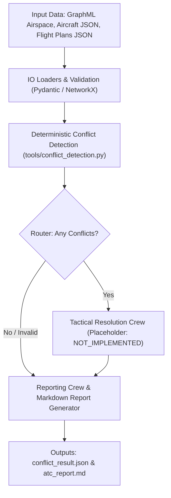

# Architecture Documentation: ATC Conflict Detection & Resolution System

## 1. System Overview
The Air Traffic Control Multi-Agent System (ATC-MAS) is a batch-processing, simulated decision-support architecture designed to detect separation conflicts between scheduled aircraft trajectories and prepare reporting and tactical resolution options.

> [!CAUTION]
> This system is an academic simulation for URV Multi-Agent Systems practical work. It is **not** an operational ATC tool and issues no real-world clearances.

## 2. Architecture & Data Flow



## 3. Key Components
1. **Domain Models (`src/atc_mas/models.py`)**:
   - Pydantic models for `Aircraft`, `FlightPlan`, `TrajectoryPoint`, `Conflict`, and `ConflictDetectionResult`.
   - Structured `ValidationIssue` tracking to ensure invalid data is never mistakenly treated as a zero-conflict scenario.
2. **Deterministic Conflict Detection (`src/atc_mas/tools/conflict_detection.py`)**:
   - Pure mathematical implementation ported from `notebooks/reference/ConflictDetection.ipynb`.
   - 4D trajectory projection and closest horizontal approach calculations.
   - Separation thresholds: 5.0 NM horizontal and 1,000 ft vertical.
3. **Crews (`src/atc_mas/crews/`)**:
   - `data_management`: Loads and verifies scenario data integrity.
   - `surveillance_conflict`: Runs deterministic conflict detection.
   - `tactical_resolution`: Interface placeholder for Task 2 maneuver planning.
   - `reporting`: Assembles structured findings and executive summaries.
4. **Flow & Router (`src/atc_mas/flows/atc_flow.py`)**:
   - Coordinates execution with conditional branching based on `ConflictDetectionResult.has_conflicts`.
5. **CLI (`src/atc_mas/cli.py`)**:
   - Run deterministic detection directly without needing any LLM API keys:
     ```bash
     python -m atc_mas detect --airspace data/input/sample_airspace.graphml --aircraft data/input/sample_aircraft.json --flight-plans data/input/sample_conflict_flight_plans.json
     ```

## 4. Scaffold Status & Deferred Work
- **Implemented**: Full data loaders, strict validation, deterministic conflict detection tool, CLI, report generator, CrewAI Flow/Crew skeleton, and 100% test coverage of reference notebook test cases.
- **Placeholder / TODO (Task 2)**: Tactical maneuver planning algorithms (`propose_resolutions`). Proposals currently return `NOT_IMPLEMENTED` and are explicitly marked as unresolved.

